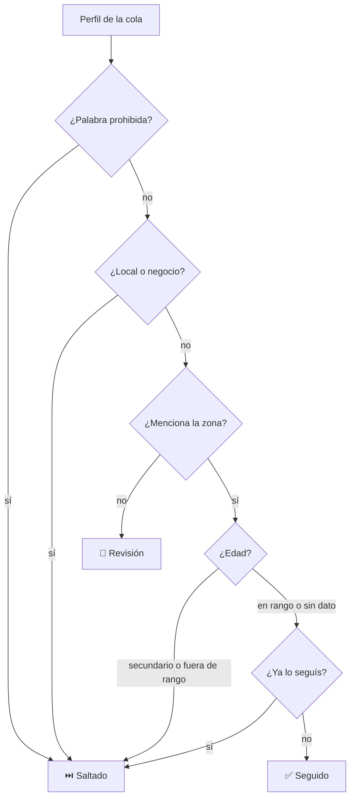

# 📲 IG Auto-Follow Bot

Extensión para Chrome y Brave pensada para **RRPP de boliches**: sigue en Instagram a una lista de usuarios y **decide a quién seguir leyendo cada perfil**, para sumar gente de tu zona y dejar afuera a quien no te sirve — DJs, locales, tiendas de ropa, menores de edad.

Todo corre en tu navegador. No hay servidor, no hay cuentas, no se manda nada a ningún lado.

---

## Qué hace

- **Cola persistente** — pegás o importás usuarios y el bot los va consumiendo con pausas aleatorias. Si Instagram recarga la página, retoma solo.
- **Filtro de zona** — sigue solo a quien menciona tu ciudad, universidad o facultad en la bio. Viene configurado para **Córdoba capital** y lee cualquier tipografía: `𝘊𝘣𝘢`, `ᴄʙᴀ`, `Ｃｂａ`, `U.N.C`.
- **Filtro de locales y negocios** — saltea boliches, bares, restaurantes, tiendas y cualquier cuenta comercial.
- **Palabras prohibidas** — saltea perfiles que mencionan lo que vos elijas (por defecto, `dj`).
- **Filtro de edad** — deduce la edad de lo que la persona escribe y saltea siempre a quien está en el secundario.
- **Revisión rápida** — los perfiles dudosos quedan en una lista donde tocás el nombre y se abre su Instagram.
- **Exportación a CSV** — al terminar, los seguidos se guardan en un archivo que abre en Excel o Google Sheets.

---

## Cómo decide a quién seguir

Cada perfil pasa por los filtros en este orden. El orden importa: un boliche cordobés tiene "Córdoba" en la bio, así que se descarta como negocio **antes** de chequear la zona.



| Resultado | Qué significa |
|---|---|
| ✅ **Seguido** | Pasó todos los filtros. El log muestra por qué: `Seguido @juan (por "famaf, ~22 años")` |
| ⏭️ **Saltado** | Se descartó con certeza: negocio, palabra prohibida, menor, ya lo seguías |
| 👀 **Revisión** | No se siguió porque no había señal de la zona. Revisalo a mano |
| ❌ **Error** | No se pudo cargar el perfil o no apareció el botón Seguir |

---

## Instalación

1. Descargá el repo (**Code → Download ZIP**) o clonalo:
   ```bash
   git clone https://github.com/JoacoMo/extension-autofollow-instagram.git
   ```
2. Abrí `chrome://extensions` (en Brave, `brave://extensions`).
3. Activá **Modo desarrollador**, arriba a la derecha.
4. Tocá **Cargar descomprimida** y elegí la carpeta **`ig-autofollow-extension`** (la que tiene el `manifest.json` adentro).
5. Fijá el ícono en la barra del navegador.

> No muevas ni borres la carpeta después de instalar: Chrome la lee desde ahí.

---

## Uso

1. Abrí **instagram.com** en una pestaña, con tu cuenta iniciada.
2. Abrí la extensión → pestaña **📋 Lista** → pegá los usuarios. Acepta `usuario`, `@usuario` o links de perfil, uno por línea o separados por coma. También podés importar un `.txt` o `.csv`.
3. En **⚙️ Config** ajustá pausas y filtros, y tocá **Guardar configuración**.
4. Volvé a **▶ Bot** y tocá **INICIAR SEGUIMIENTO**.

Mientras corre, el log muestra cada decisión y su motivo.

---

## Configuración de filtros

Todo se ajusta desde **⚙️ Config**, sin tocar código.

### Zona

Busca la palabra completa, no fragmentos: `unc` no matchea dentro de "nunca". Viene cargado con:

- **Ciudad**: córdoba, cba, cordobés/a, la docta, 351 (característica telefónica)
- **Universidades**: UNC, UTN FRC, UPC, UCC, UBP, Siglo 21, IUA, ISPC
- **Facultades de la UNC**: FAMAF, FCEFyN, FFyH, FCM, FCQ, FCC, FAUD, FCS, FCE, FCA, Lenguas, Odontología
- **Colegios**: Monserrat, Manuel Belgrano, Carbó

Con **"Incluir interior / Gran Córdoba"** también suma Carlos Paz, Alta Gracia, Villa Allende, Río Cuarto, Villa María, etc.

En **"Siglas o palabras extra"** agregás las tuyas, una por línea. Terminá una palabra en `*` para aceptar cualquier final: `cordobes*` matchea "cordobesa".

> **¿Sos de otra provincia?** Cargá tus siglas en "palabras extra", o reemplazá la lista `TERMINOS_CORDOBA` en [`content.js`](ig-autofollow-extension/content.js).

### Locales y negocios

Detecta la cuenta comercial de tres formas:

1. **Botones que Instagram solo muestra en cuentas de negocio**: "Cómo llegar", "Ver tienda", "Reservar", "Pedir comida". Es la señal más confiable: si ofrece cómo llegar, hay un local atrás.
2. **Categoría profesional** bajo el nombre: "Empresa local", "Club nocturno", "Tienda de…".
3. **Rubro y vocabulario comercial**: boliche, discoteca, bar, cervecería, restaurante, boutique, indumentaria, showroom, delivery, envíos, reservas, turnos, promos…

Sumá rubros propios en **"Rubros extra a saltar"**.

### Edad

Instagram no expone la edad, así que se **deduce del texto** que escribe la persona:

| Pista en la bio | Qué deduce |
|---|---|
| `21 años`, `22yo` | Edad directa |
| `🎂 15/06/2003` | Año de nacimiento |
| `promo 2021` | Egresó a los ~18 |
| `'04`, `2003` | Año de nacimiento |

- Si alguien menciona que **cursa el secundario** (promo de este año o futura, "6to año"), se saltea siempre, sin importar el rango.
- Si no hay ninguna pista, no inventa un número: lo deja pasar. Activá **"Mandar a revisión si no se puede deducir la edad"** para ser más estricto.
- **No analiza fotos.** Estimar la edad por la cara falla por varios años y genera datos biométricos de terceros.

### Exportación

Los seguidos se guardan en **`Descargas/ig-seguidos/seguidos-FECHA.csv`** al terminar la lista, al detener el bot o con **💾 Exportar CSV** en Historial.

| usuario | fecha | hora | motivo | perfil |
|---|---|---|---|---|
| juan.perez | 16/8/2026 | 11:32:10 | famaf, ~22 años | https://www.instagram.com/juan.perez/ |

Para Google Sheets: **Archivo → Importar → Subir**.

Con **"Vaciar el historial después de exportar"** activado (por defecto), la lista se borra del navegador una vez que el archivo se guardó.

---

## Probar los filtros

Desde la consola del navegador (F12), con un perfil de Instagram abierto:

```js
__afFiltro.perfilActual()                  // evalúa el perfil que estás viendo
__afFiltro.probar('𝘊𝘣𝘢 | ғᴀᴍᴀꜰ | 21 años')  // evalúa un texto cualquiera
__afFiltro.edad('promo 2021 unc')          // solo el filtro de edad
__afFiltro.normalizar('ᴄᴏʀᴅᴏʙᴀ')            // cómo queda el texto tras normalizar
```

---

## Recomendaciones para evitar bloqueos

- Pausas de **20 a 40 segundos** entre follows.
- No más de **80 a 120 follows por día**.
- Usalo en tandas, no todo el día.
- Si Instagram te pide verificación o te bloquea una acción, detené el bot y esperá unas horas.

---

## Privacidad

- No hay servidor ni analytics: la extensión solo se comunica con `instagram.com`.
- La cola y la configuración viven en el almacenamiento local de la extensión, necesario para retomar si la página recarga.
- Los seguidos se exportan a tu carpeta de Descargas y, por defecto, se borran del navegador.
- El `.gitignore` excluye los CSV exportados y las listas de usuarios, para que no terminen en un repo por accidente.

---

## Estructura

```
ig-autofollow-extension/
├── manifest.json    Permisos y registro de la extensión (Manifest V3)
├── background.js    Service worker: cola, estado, pausas, exportación CSV
├── content.js       Corre en instagram.com: lee el perfil, filtra y sigue
├── popup.html       Interfaz del popup
├── popup.js         Lógica del popup
└── icons/
```

---

## Aviso

Automatizar acciones en Instagram va en contra de sus [Condiciones de uso](https://help.instagram.com/581066165581870) y puede terminar en bloqueos temporales o en la suspensión de la cuenta. Usala bajo tu propia responsabilidad, con una cuenta que estés dispuesto a arriesgar.

Este proyecto no está afiliado a Instagram ni a Meta.
