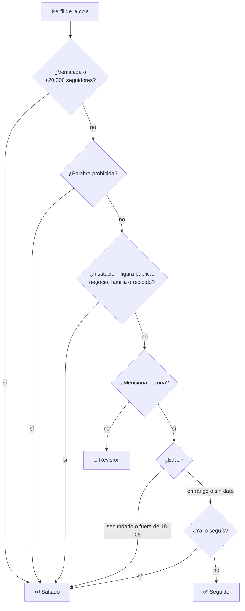

# 📲 IG Auto-Follow Bot

Extensión para Chrome y Brave pensada para **RRPP de boliches**: sigue en Instagram a una lista de usuarios y **decide a quién seguir leyendo cada perfil**, para sumar gente de tu zona y dejar afuera a quien no te sirve — DJs, locales, tiendas de ropa, menores de edad.

Todo corre en tu navegador. No hay servidor, no hay cuentas, no se manda nada a ningún lado.

---

## Qué hace

- **Cola persistente** — pegás o importás usuarios y el bot los va consumiendo con pausas aleatorias. Si Instagram recarga la página, retoma solo.
- **Filtro de zona** — sigue solo a quien menciona tu ciudad, universidad o facultad en la bio. Viene configurado para **Córdoba capital** y lee cualquier tipografía: `𝘊𝘣𝘢`, `ᴄʙᴀ`, `Ｃｂａ`, `U.N.C`.
- **Filtro de locales y negocios** — saltea boliches, bares, restaurantes, tiendas, emprendimientos y cualquier cuenta comercial.
- **Solo estudiantes** — saltea instituciones y cuentas oficiales, figuras públicas, mamás y papás, y profesionales ya recibidos.
- **Palabras prohibidas** — saltea perfiles que mencionan lo que vos elijas (por defecto, `dj`).
- **Filtro de edad** — deduce la edad de lo que la persona escribe, por defecto entre 18 y 26, y saltea siempre a quien está en el secundario.
- **Revisión perfil por perfil** — los dudosos van a una tarjeta donde ves foto, bio y últimas publicaciones, y decidís con dos botones: descartar o seguir. Se abre dentro de Instagram, en el popup o en una pestaña aparte.
- **Exportación a CSV** — al terminar, los seguidos se guardan en un archivo que abre en Excel o Google Sheets.

---

## Cómo decide a quién seguir

Cada perfil pasa por los filtros en este orden. El orden importa: la facultad, el boliche y la heladería de Córdoba también tienen "Córdoba" en la bio, así que todo lo que descarta se chequea **antes** que la zona.



| Resultado | Qué significa |
|---|---|
| ✅ **Seguido** | Pasó todos los filtros. El log muestra por qué: `Seguido @juan (por "famaf, ~22 años")` |
| ⏭️ **Saltado** | Se descartó con certeza: institución, figura pública, negocio, familia armada, ya recibido, fuera del rango de edad, o ya lo seguías |
| 👀 **Revisión** | No se siguió porque no había señal de la zona. Revisalo a mano |
| ❌ **Error** | No se pudo cargar el perfil o no apareció el botón Seguir |

---

## Instalación

1. Descargá el repo (**Code → Download ZIP**) o clonalo:
   ```bash
   git clone https://github.com/JoacoMo/extension-autofollow-instagram.git
   ```
2. Abrí `chrome://extensions` (en Brave, `brave://extensions`).
3. Activá **Modo desarrollador**, arriba a la derecha.
4. Tocá **Cargar descomprimida** y elegí la carpeta **`ig-autofollow-extension`** (la que tiene el `manifest.json` adentro).
5. Fijá el ícono en la barra del navegador.

> No muevas ni borres la carpeta después de instalar: Chrome la lee desde ahí.

---

## Uso

1. Abrí **instagram.com** en una pestaña, con tu cuenta iniciada.
2. Abrí la extensión → pestaña **📋 Lista** → pegá los usuarios. Acepta `usuario`, `@usuario` o links de perfil, uno por línea o separados por coma. También podés importar un `.txt` o `.csv`.
3. En **⚙️ Config** ajustá pausas y filtros, y tocá **Guardar configuración**.
4. Volvé a **▶ Bot** y tocá **INICIAR SEGUIMIENTO**.

Mientras corre, el log muestra cada decisión y su motivo.

---

## Configuración de filtros

Todo se ajusta desde **⚙️ Config**, sin tocar código.

### Zona

Busca la palabra completa, no fragmentos: `unc` no matchea dentro de "nunca". Viene cargado con:

- **Ciudad**: córdoba, cba, cordobés/a, la docta, 351 (característica telefónica)
- **Universidades**: UNC, UTN FRC, UPC, UCC, UBP, Siglo 21, IUA, ISPC
- **Facultades de la UNC**: FAMAF, FCEFyN, FFyH, FCM, FCQ, FCC, FAUD, FCS, FCE, FCA, Lenguas, Odontología
- **Colegios**: Monserrat, Manuel Belgrano, Carbó

Con **"Incluir interior / Gran Córdoba"** también suma Carlos Paz, Alta Gracia, Villa Allende, Río Cuarto, Villa María, etc.

En **"Siglas o palabras extra"** agregás las tuyas, una por línea. Terminá una palabra en `*` para aceptar cualquier final: `cordobes*` matchea "cordobesa".

> **¿Sos de otra provincia?** Cargá tus siglas en "palabras extra", o reemplazá la lista `TERMINOS_CORDOBA` en [`content.js`](ig-autofollow-extension/content.js).

### Locales y negocios

Detecta la cuenta comercial de tres formas:

1. **Botones que Instagram solo muestra en cuentas de negocio**: "Cómo llegar", "Ver tienda", "Reservar", "Pedir comida". Es la señal más confiable: si ofrece cómo llegar, hay un local atrás.
2. **Categoría profesional** bajo el nombre: "Empresa local", "Club nocturno", "Tienda de…".
3. **Rubro y vocabulario comercial**: boliche, discoteca, bar, cervecería, restaurante, boutique, indumentaria, showroom, delivery, envíos, reservas, turnos, promos…

Sumá rubros propios en **"Rubros extra a saltar"**. También entran los emprendimientos: tortas, uñas, tatuajes, fotografía, indumentaria, "pedidos por DM", "envíos a todo el país".

### Solo estudiantes

El público del boliche es gente que estudia. Estas cuatro categorías se saltean por separado y se pueden apagar una por una:

| Categoría | Qué saltea | Ejemplos de la bio |
|---|---|---|
| **Instituciones** | Cuentas que no son una persona | "Universidad Nacional de…", "Centro de Estudiantes", "Municipalidad", "Club Atlético", "Parroquia", "Hospital" |
| **Figuras públicas** | Famosos, artistas, influencers | "Cantante", "Creadora de contenido", "Booking", "Streamer" |
| **Familia armada** | Mamás, papás, gente casada | "Mamá de Benja", "Casada 💍", "Mi esposo" |
| **Recibidos** | Profesionales que ya terminaron | "Abogada", "Lic. en Nutrición", "Ing. Civil", "Egresada 2018" |

Dos detalles que evitan falsos positivos:

- **"Futura abogada" es una estudiante.** Si el perfil dice que estudia (`estudiante de`, `cursando`, `futura`, `alumna`, `facu`…), las palabras de profesión no lo descartan. Lo mismo con las instituciones: una facultad no escribe "estudiante de", escribe "formamos estudiantes".
- **Las frases van completas.** `mamá` suelta aparece en cualquier bio ("mamá te amo"), así que se busca `mamá de`. `unc` no matchea dentro de "nunca", ni `licenciada` dentro de "licenciatura".

Aparte del texto, se saltea **toda cuenta verificada** y toda cuenta con más seguidores que el tope configurado (20.000 por defecto). Es la señal más confiable de que no es un estudiante cualquiera.

Con **"Mandar a revisión si no dice que estudia"** el filtro se pone estricto: ya no alcanza con nombrar Córdoba, tiene que aparecer la facultad, la carrera o que está estudiando.

### Edad

Instagram no expone la edad, así que se **deduce del texto** que escribe la persona:

| Pista en la bio | Qué deduce |
|---|---|
| `21 años`, `22yo` | Edad directa |
| `🎂 15/06/2003` | Año de nacimiento |
| `promo 2021` | Egresó a los ~18 |
| `'04`, `2003` | Año de nacimiento |

El rango por defecto es **18 a 26**. Si ya habías guardado la configuración con el tope viejo (99), se actualiza solo la primera vez; si después lo cambiás a mano, queda como lo dejaste.

- Si alguien menciona que **cursa el secundario** (promo de este año o futura, "6to año"), se saltea siempre, sin importar el rango.
- Si no hay ninguna pista, no inventa un número: lo deja pasar. Activá **"Mandar a revisión si no se puede deducir la edad"** para ser más estricto.
- **No analiza fotos.** Estimar la edad por la cara falla por varios años y genera datos biométricos de terceros.

---

## Revisión perfil por perfil

Los perfiles que el bot no pudo clasificar van a **Revisión** y los resolvés de a uno. Es la misma tarjeta en los tres lados, usá el que te quede cómodo:

| Dónde | Cómo se abre |
|---|---|
| **Sin salir de Instagram** | Botón flotante abajo a la derecha, con la cantidad pendiente. Aparece solo cuando hay alguien esperando |
| **En el popup** | La tarjeta **Revisión** del tab Bot, o **🔍 Revisar acá** en Historial |
| **En una pestaña aparte** | **↗ En pestaña**, para verlo en grande |

En cada perfil ves:

- **Foto de perfil y últimas 9 publicaciones**, en grilla. Click en cualquiera para ampliarla.
- **Nombre, bio, link y números** de posts, seguidores y seguidos.
- **Etiquetas de contexto** con lo que opinaron los filtros: qué término de zona encontró, la edad que dedujo, o si lo detectó como negocio.
- **Abrir y ver más en Instagram**, que abre el perfil en otra pestaña sin perder la revisión.
- Dos botones: **✕ Descartar** (lo saca de la lista) y **✓ Seguir**.

Atajos: `←` descartar, `→` seguir, `espacio` abrir en Instagram, `Esc` cerrar la foto ampliada o el panel. Dentro de Instagram responden solo con el mouse sobre el panel, para no pisar los atajos de IG.

El panel flotante lee los perfiles de la pestaña donde estás parado. Desde el popup o desde la pestaña aparte necesitás tener Instagram abierto en alguna pestaña, con tu sesión: de ahí salen los datos. Mientras mirás un perfil, el siguiente ya se está cargando.

Lo que sigas desde acá también entra al CSV, con el motivo `aprobado en revisión`.

> Si el botón flotante te molesta, se apaga en **⚙️ Config → Panel dentro de Instagram**.

---

## Revisar desde el celular

Mirar las fotos se hace más cómodo en el teléfono, pero **Chrome en el celular no soporta extensiones**. La solución es un *userscript*: un solo archivo que corre dentro de instagram.com y monta la misma tarjeta, con los mismos filtros. Está en [`movil/ig-revision.user.js`](movil/ig-revision.user.js).

Es solo la revisión: **el bot se queda en la compu**. Necesita el navegador abierto horas con pausas, y lee botones del Instagram de escritorio que en el celular no existen.

### Instalarlo en el iPhone

1. Instalá **[Userscripts](https://apps.apple.com/app/userscripts/id1463298887)** desde la App Store (gratis y open source).
2. Abrí **Ajustes → Apps → Safari → Extensiones**, activá *Userscripts* y en instagram.com elegí **Permitir siempre**.
3. Abrí la app Userscripts una vez y elegí la carpeta donde va a guardar los scripts.
4. En Safari, abrí el [archivo crudo del userscript](https://raw.githubusercontent.com/JoacoMo/extension-autofollow-instagram/main/movil/ig-revision.user.js), tocá sobre el texto, **Seleccionar todo → Copiar**.
5. En la app Userscripts tocá **+ → New userscript**, pegá todo y guardá.
6. Entrá a instagram.com desde Safari: abajo a la derecha aparece **👀 Revisar**.

> En Android es el mismo archivo, con **Firefox + Violentmonkey** en vez de Safari.

### Cómo se usa

1. En la compu, pestaña **📊 Historial → Copiar revisión**, y mandate la lista por WhatsApp o notas.
2. En el celular tocá **👀 Revisar** y pegala en el cuadro. Acepta comas, saltos de línea, `@` y links de perfil.
3. Revisá igual que en la compu: foto, bio, publicaciones, seguidores en común y los dos botones.
4. Cuando termines, **Copiar seguidos** te deja la lista para pegarla en la compu si querés tenerla en el CSV.

La cola queda guardada en el navegador del teléfono, así que podés cerrar Instagram y seguir después.

> **El archivo no se edita a mano.** Lo genera `node movil/construir.js`, que toma el motor de filtros y las llamadas a la API de [`content.js`](ig-autofollow-extension/content.js) y la tarjeta de [`revision-ui.js`](ig-autofollow-extension/revision-ui.js). Así el celular y la compu filtran igual, sin dos copias que se desincronicen.

> El botón verde sigue **al instante**, sin las pausas del bot automático. Como el ritmo lo ponés vos mirando cada perfil, suele ser más lento que el bot — pero no lo uses a toda velocidad.

---

### Exportación

Los seguidos se guardan en **`Descargas/ig-seguidos/seguidos-FECHA.csv`** al terminar la lista, al detener el bot o con **💾 Exportar CSV** en Historial.

| usuario | fecha | hora | motivo | perfil |
|---|---|---|---|---|
| juan.perez | 16/8/2026 | 11:32:10 | famaf, ~22 años | https://www.instagram.com/juan.perez/ |

Para Google Sheets: **Archivo → Importar → Subir**.

Con **"Vaciar el historial después de exportar"** activado (por defecto), la lista se borra del navegador una vez que el archivo se guardó.

---

## Probar los filtros

Desde la consola del navegador (F12), con un perfil de Instagram abierto:

```js
__afFiltro.perfilActual()                   // evalúa el perfil que estás viendo
__afFiltro.probar('𝘊𝘣𝘢 | ғᴀᴍᴀꜰ | 21 años')   // evalúa un texto cualquiera
__afFiltro.probar('Futura abogada | UNC')   // → cordoba (dice que estudia)
__afFiltro.probar('Abogada | Córdoba')      // → profesion
__afFiltro.edad('promo 2021 unc')           // solo el filtro de edad
__afFiltro.fama({ verificado: true })       // solo el filtro de figura pública
__afFiltro.normalizar('ᴄᴏʀᴅᴏʙᴀ')             // cómo queda el texto tras normalizar
```

---

## Recomendaciones para evitar bloqueos

- Pausas de **20 a 40 segundos** entre follows.
- No más de **80 a 120 follows por día**.
- Usalo en tandas, no todo el día.
- Si Instagram te pide verificación o te bloquea una acción, detené el bot y esperá unas horas.

---

## Privacidad

- No hay servidor ni analytics: la extensión solo se comunica con `instagram.com` y con el CDN donde Instagram aloja las fotos.
- La cola y la configuración viven en el almacenamiento local de la extensión, necesario para retomar si la página recarga.
- Los seguidos se exportan a tu carpeta de Descargas y, por defecto, se borran del navegador.
- El `.gitignore` excluye los CSV exportados y las listas de usuarios, para que no terminen en un repo por accidente.

---

## Estructura

```
ig-autofollow-extension/
├── manifest.json    Permisos y registro de la extensión (Manifest V3)
├── background.js    Service worker: cola, estado, pausas, exportación CSV
├── content.js       Corre en instagram.com: lee el perfil, filtra, sigue y monta el panel
├── popup.html       Interfaz del popup
├── popup.js         Lógica del popup
├── revision-ui.js   La tarjeta de revisión, compartida por los tres lugares donde se abre
├── revision.html    Revisión en pestaña completa
├── revision.js      Arranque de esa pestaña
└── icons/

movil/
├── ig-revision.user.js  Userscript para el celular (generado, no se edita)
├── revision-movil.js    Arranque del celular: cola en el navegador, pegar lista
└── construir.js         Arma el userscript con los tramos de la extensión
```

---

## Aviso

Automatizar acciones en Instagram va en contra de sus [Condiciones de uso](https://help.instagram.com/581066165581870) y puede terminar en bloqueos temporales o en la suspensión de la cuenta. Usala bajo tu propia responsabilidad, con una cuenta que estés dispuesto a arriesgar.

Este proyecto no está afiliado a Instagram ni a Meta.
